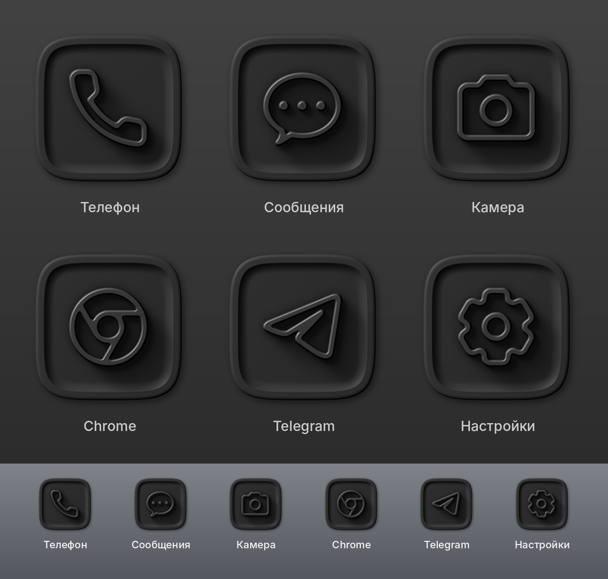

# My-Icon — графитовый icon pack для Android

Тёмная матовая плитка-squircle (~#2A2A2A) с рамкой, углублением-«блюдцем»
и выпуклым монохромным значком. Свет сверху-слева, одна гамма.

* `tools/iconstyle.py` — рендер стиля (Python + Pillow + NumPy), всё рисуется скриптом.
* `tools/preview.py` — лист с пробными иконками: `preview/samples_v1.png`.
* Значки: [Lawnicons](https://github.com/LawnchairLauncher/lawnicons), Apache-2.0 (см. `NOTICE`).

Пробный рендер:

```
pip install -r requirements.txt
git clone --depth 1 https://github.com/LawnchairLauncher/lawnicons /tmp/lawnicons
python tools/preview.py /tmp/lawnicons/svgs preview/samples_v1.png
```


