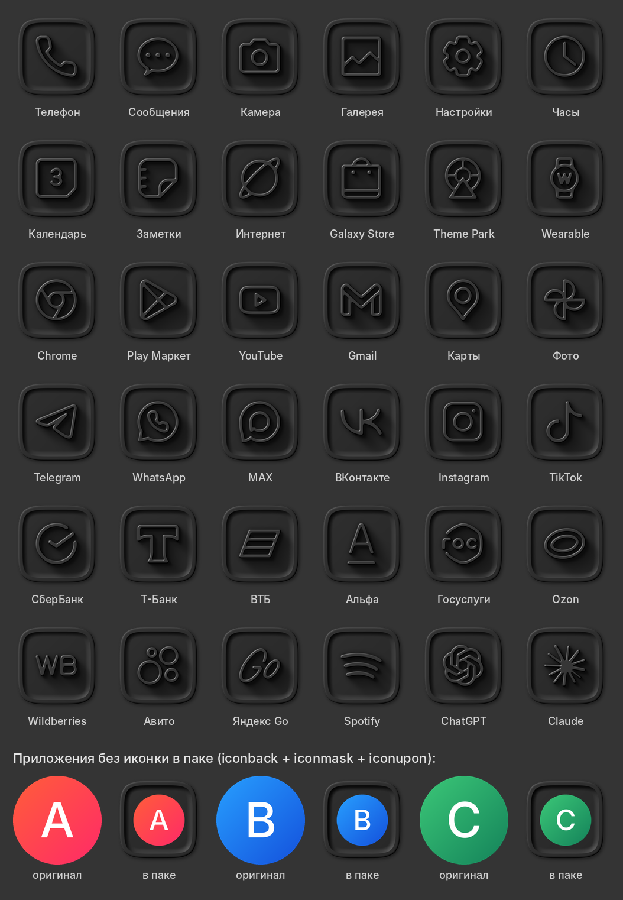
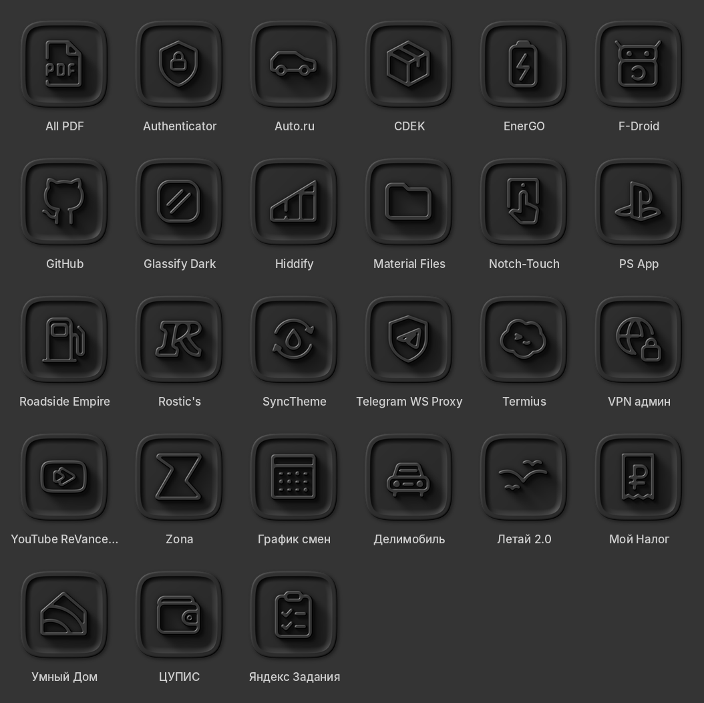

# My-Icon — графитовый icon pack для Android

Тёмная матовая плитка-squircle (~#2A2A2A) с рамкой, углублением-«блюдцем»
и выпуклым монохромным значком. Свет сверху-слева, одна гамма.

**Скачать APK:** https://github.com/0WahTanG0/My-Icon/releases/latest/download/My-Icon.apk



Версия 2 — иконки для всех приложений с телефона владельца
(12 нарисованы заново, `tools/make_glyphs.py`):



## Как применить

* **Samsung:** Theme Park → «Значки» → создать новый набор из пакета значков My-Icon → применить.
* **Nova:** Настройки → Внешний вид → Стиль значков → Тема значков → My-Icon (или кнопка в приложении).
* **Lawnchair:** Настройки → Общие → Пакет значков → My-Icon.

Формат стандартный: `appfilter.xml` и `drawable.xml` (в `res/xml` и в `assets`),
`iconback` / `iconmask` / `iconupon` + `scale` для приложений без своей иконки.

## Версия 2 со всеми вашими приложениями

В приложении My-Icon нажмите **«Скопировать список моих приложений»** и пришлите текст.
Это приложения, для которых в паке ещё нет иконки (`название | пакет/activity`).

## Как это устроено

| Путь | Что это |
|---|---|
| `tools/iconstyle.py` | рендер стиля: карта высот (рамка + блюдце + значок), свет, тени. Python + Pillow + NumPy |
| `pack/apps.txt` | какие приложения входят в пак (пакеты, префиксы, свои соответствия) |
| `tools/vendor_lawnicons.py` | берёт нужные SVG и записи appfilter из Lawnicons → `third_party/lawnicons`, `pack/selection.json` |
| `pack/glyphs/*.svg` | свои значки (192×192, линия 12) для того, чего нет в Lawnicons; генерирует `tools/make_glyphs.py` |
| `tools/build_pack.py` | рисует все PNG 256×256 и генерирует `appfilter.xml`, `drawable.xml`, иконку приложения |
| `android/` | приложение пака (Java, без зависимостей) |
| `.github/workflows/build.yml` | сборка подписанного APK и публикация в Releases |
| `version.properties` | версия; новая `versionName` = новый релиз `v<versionName>` |

Сборка вручную:

```
pip install -r requirements.txt
python tools/build_pack.py
cd android && ./gradlew assembleRelease
```

Добавить приложения: дописать пакеты в `pack/apps.txt`, затем
`python tools/vendor_lawnicons.py <путь к клону Lawnicons>`.

## Подпись

APK подписывается ключом `signing/release.jks` (лежит в репозитории, чтобы каждая
новая версия ставилась поверх старой). Репозиторий публичный, поэтому этим ключом
может подписать APK кто угодно. Чтобы держать ключ в секрете, задайте секреты
`SIGNING_KEYSTORE_B64`, `SIGNING_STORE_PASSWORD`, `SIGNING_KEY_ALIAS`,
`SIGNING_KEY_PASSWORD`: workflow использует их вместо файла. Новый ключ потребует
один раз удалить старую версию пака перед установкой.

## Лицензии

Значки: [Lawnicons](https://github.com/LawnchairLauncher/lawnicons), Apache-2.0
(`third_party/lawnicons/LICENSE`, `NOTICE`). Названия и логотипы приложений
принадлежат их владельцам.
