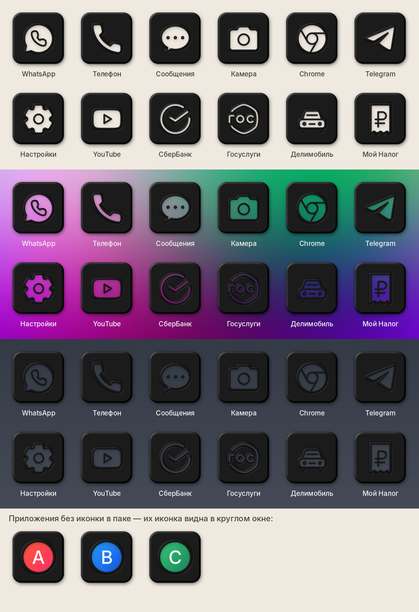
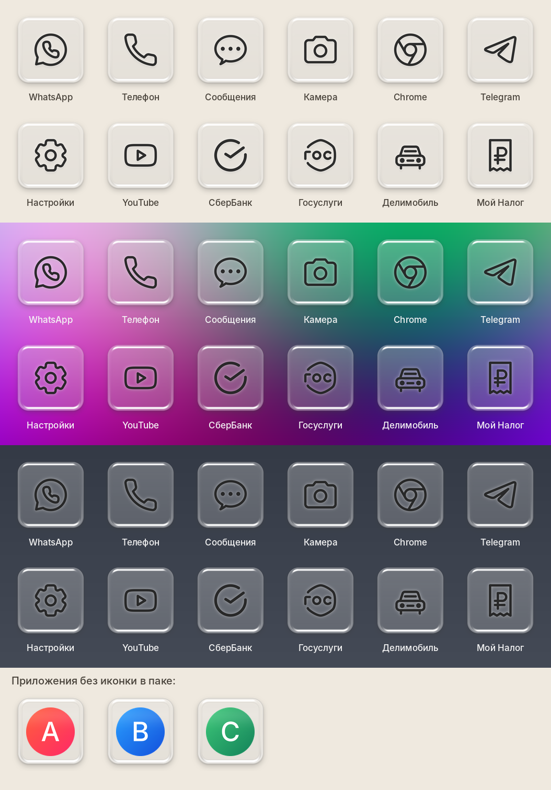
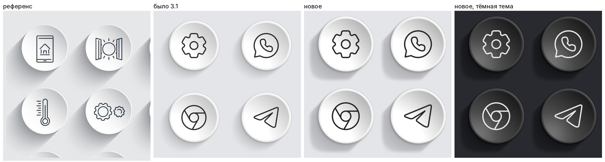

# My-Icon — icon pack для Android, четыре стиля в одном приложении

Одно приложение `com.myicon.graphite`. Стиль выбирается внутри приложения
(раздел «Стиль иконок»): оно скачивает выбранный вариант из последнего релиза и
ставит его поверх себя. Там же обновления; новые стили появляются в списке сами
(`styles.json` в релизе).

**Скачать:** https://github.com/0WahTanG0/My-Icon/releases/latest/download/My-Icon-white.apk
(или `My-Icon-graphite.apk`, `My-Icon-noir.apk`, `My-Icon-glass.apk`)

| Стиль | Модуль | Превью |
|---|---|---|
| Графит: тёмная плитка, блюдце, выпуклый значок | `tools/iconstyle.py` |  |
| Noir: чёрная плита, значок вырезан насквозь | `tools/style_noir.py` |  |
| Стекло: прозрачное толстое стекло | `tools/style_glass.py` |  |
| Белый: белое блюдце, длинная тень; в тёмной теме графитовое (`drawable-night`) | `tools/style_white.py` |  |

Иконки для приложений владельца (12 нарисованы заново, `tools/make_glyphs.py`):


## Как применить

* **Samsung:** Theme Park → «Значки» → создать новый набор из пакета значков My-Icon → применить.
* **Nova:** Настройки → Внешний вид → Стиль значков → Тема значков → My-Icon (или кнопка в приложении).
* **Lawnchair:** Настройки → Общие → Пакет значков → My-Icon.

Формат стандартный: `appfilter.xml` и `drawable.xml` (в `res/xml` и в `assets`),
`iconback` / `iconmask` / `iconupon` + `scale` для приложений без своей иконки.

## Новые приложения

В приложении нажмите **«Скопировать список моих приложений»** и пришлите текст:
это приложения, для которых ещё нет иконки (`название | пакет/activity`).

## Как это устроено

| Путь | Что это |
|---|---|
| `tools/iconstyle.py` | рендер стиля: карта высот (рамка + блюдце + значок), свет, тени. Python + Pillow + NumPy |
| `pack/apps.txt` | какие приложения входят в пак (пакеты, префиксы, свои соответствия) |
| `tools/vendor_lawnicons.py` | берёт нужные SVG и записи appfilter из Lawnicons → `third_party/lawnicons`, `pack/selection.json` |
| `pack/glyphs/*.svg` | свои значки (192×192, линия 12) для того, чего нет в Lawnicons; генерирует `tools/make_glyphs.py` |
| `tools/build_pack.py` | рисует все PNG 256×256 и генерирует `appfilter.xml`, `drawable.xml`, иконку приложения; `--pack graphite\|noir\|glass\|white` |
| `android/` | приложение (Java, без зависимостей): flavor на каждый стиль, переключение стиля и обновления (`StylesCard`, `Installer`) |
| `.github/workflows/build.yml` | рисует все стили, собирает подписанные APK, публикует один релиз со всеми стилями, `styles.json` и превью |
| `pack/styles.json`, `tools/release_extras.py` | список стилей для приложения и полоски-превью |
| `version.properties` | одна версия на все стили; релиз `v<версия>` |

Сборка вручную:

```
pip install -r requirements.txt
python tools/build_pack.py --pack graphite
python tools/build_pack.py --pack noir
python tools/build_pack.py --pack glass
python tools/build_pack.py --pack white
cd android && ./gradlew assembleRelease
```

Добавить приложения: дописать пакеты в `pack/apps.txt`, затем
`python tools/vendor_lawnicons.py <путь к клону Lawnicons>`.

## Подпись

APK подписывается ключом `signing/release.jks` (лежит в репозитории, чтобы каждая
новая версия ставилась поверх старой). Репозиторий публичный, поэтому этим ключом
может подписать APK кто угодно. Чтобы держать ключ в секрете, задайте секреты
`SIGNING_KEYSTORE_B64`, `SIGNING_STORE_PASSWORD`, `SIGNING_KEY_ALIAS`,
`SIGNING_KEY_PASSWORD`: workflow использует их вместо файла. Новый ключ потребует
один раз удалить старую версию пака перед установкой.

## Лицензии

Значки: [Lawnicons](https://github.com/LawnchairLauncher/lawnicons), Apache-2.0
(`third_party/lawnicons/LICENSE`, `NOTICE`). Названия и логотипы приложений
принадлежат их владельцам.
